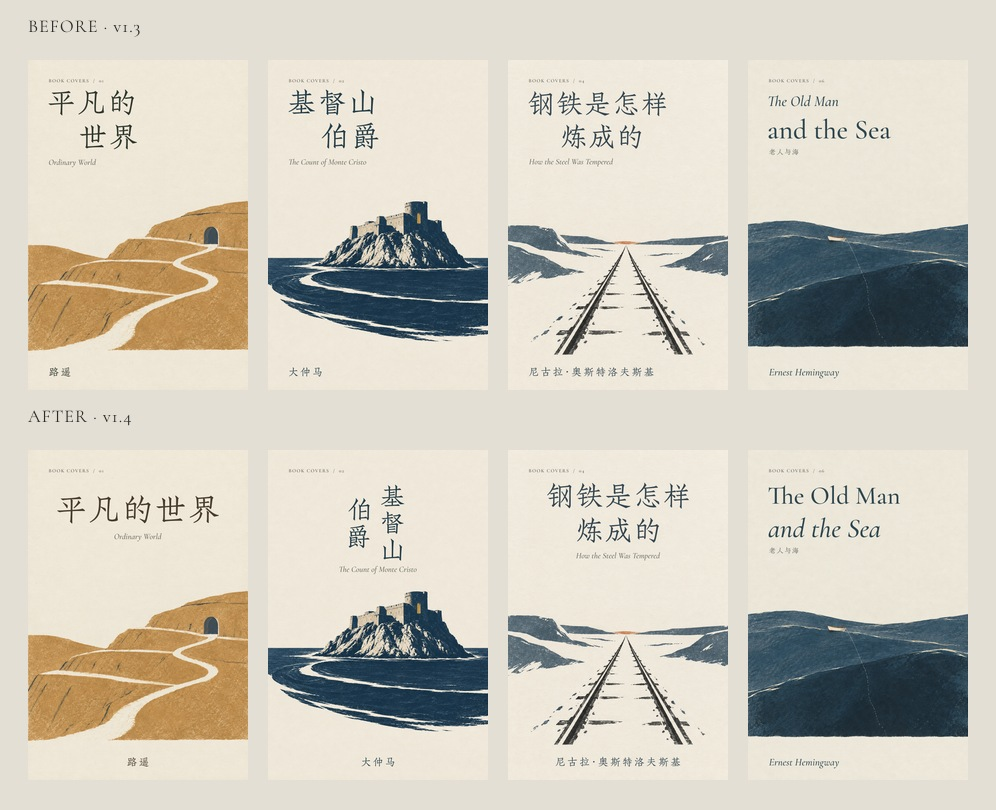

# v1.4.0：三项交付、排版优化与对抗性审查

2026-10-16。审查对象为 Book Covers 画廊、独立 Skill、排版运行工具及当前说明。结论：默认交付已经统一为**无字 PNG、非生图文字的排版 PNG、可复制生图提示词**；独立试用发现的两类缺陷已修复并复测。在已测试范围内没有剩余已证实的功能缺陷，不等于所有环境或审美判断都已验证。

## 设计改动

- 《平凡的世界》：五字一行、同等尺度，稳定标题与画面的重心。
- 《基督山伯爵》：由机械缩进改为右起竖排，题字回应下方孤岛。
- 《钢铁是怎样炼成的》：两行同轴，呼应铁路的消失点。
- The Old Man and the Sea：收敛两行字号差，保留真正的斜体。

《红楼梦》《边城》《到灯塔去》《白马啸西风》作为认可的基准，八张中英文封面未动。全部十张插画保持原 SHA-256。相同本机环境对比二十张 PNG，只有上述四张改变，其余十六张字节一致：[哈希对比](review-evidence/v1.4.0/cover-comparison.json)。

## 独立试用与对抗审查

使用一个独立 Agent，给出真实的《边城》中文请求和用户选定的插画/提示词，未提供预期缺陷或修复答案。它在临时目录复制完整 Skill，独立安装依赖、按固定源下载并校验字体，没有使用画廊的 node_modules、运行工具或本地字体文件。试用系统：macOS arm64，Node 26.5.0，npm 11.17.0。

实际输出三个文件；打开检查了 1024 × 1536 原图、成品及 180 px 缩略图。原图与提示词逐字节保持；合成图在标题和作者区域以外没有像素改变。[交付证据](review-evidence/v1.4.0/delivery-check.json) · [像素检查](review-evidence/v1.4.0/pixel-check.json)。

| 发现 | 复现与影响 | 修复及复测 |
|---|---|---|
| P2：横排视觉顺序未验证 | `titleLines=["边","城"]` 配 `[490,250]` 基线，文字数据正确却渲染成“城边” | 横排基线必须由上到下递增；原复现被拒绝，正常作品不变 |
| P2：审计文件可覆盖新 PNG | `--force` 下，receipt 经目录符号链接或大小写不同文件名指向新导出 PNG，曾返回成功却用 JSON 覆盖成品；未发现原图保护被绕过 | 解析真实父目录，保守处理大小写/Unicode 规范化，拒绝输出别名及父子路径；receipt 写入前再保护所有新输出。两种别名均复测拒绝 |
| 环境兼容说明 | macOS `/tmp` 别名搭配 npm `--prefix` 曾报安装路径错误；进入目录后安装成功 | 使用 `cd runtime` 后 `npm ci`，不将环境现象误报为锁文件损坏 |

[最终独立复测结果](review-evidence/v1.4.0/final-results.json)包含原有文件保护、源图保护、缺字、重叠、倒序、目录别名和大小写碰撞。修复后有效《边城》三个文件与首次正常交付逐字节一致。回归用例已加入 `tests/compose.test.mjs`。

## 已更新的过时内容

- 删除“无字图只是中间素材、仅明确要求才交付”的默认规则。
- 移除“字体不方便就让生图画文字”的默认兜底。历史实验及实际生成记录继续保留在 `process/`，不再装入 Skill。
- Skill 包含独立运行工具、依赖锁文件、字体来源及许可；不再声称没有本地运行要求。首次需要 Node/npm 和网络准备，之后读取缓存字体，不安装系统字体。
- 单语请求不再强制虚构英文翻译、双语成品或系列编号；WebP 和审计 JSON 改为显式选项。
- 更新安装脚本：先备份再完整替换，避免合并时残留旧规则；发布包排除依赖目录和字体缓存。
- 修改画廊下载区域：三项输出常驻，提示词可直接复制或下载；修正后的可复用生成配方与历史实际提示词分开标明。
- 同步中英文 README、安装说明、排版参考、Skill 元数据、视觉样张和设计文档。旧版本发布说明明确作为历史记录保留。

## 验证与范围

- 本地全套检查涵盖 18 个测试、20 个排版方案、源图完整性和静态服务；构建生成 23 个 HTML 页面，全部本地页面链接通过检查。
- 单语三文件、双语四文件、真实标题/作者像素、原图和 prompt 字节保持、可选 WebP/receipt 均实测。
- 正式安装目录中的 Skill 另行完成中文毛笔《白马啸西风》与英文《到灯塔去》，均实际准备所需字体并输出三件文件。
- 浏览器检查中文桌面与 390 px 英文布局、语言切换、图层切换；图片加载完整，无横向溢出。三类 HTTP 下载内容与构建文件哈希一致。
- 复制按钮的成功反馈与拒绝时展开提示词均观察到。当前自动化浏览器的虚拟剪贴板未可靠反映页面的系统剪贴板，故未将其算作完整的“复制后实际粘贴”验收；全文展示与 TXT 下载均可用。
- Skill 格式校验通过。GitHub Actions 对正式提交在 Node 22/Linux 上执行的结果，以仓库的实际工作流记录为准。

没有重新生成十张插画；本轮不声称验证了新提示词的随机生成质量，也没有把独立试用扩展成所有平台兼容认证。

## 离更好的封面还有什么差距

1. **构图同质化。** 上部题字、下部景物让系列统一，但连续浏览也容易预测。下一张新作应从书的冲突重新决定空间，不必再次选择道路、远景或孤立建筑。
2. **字体尚未逐本定制。** 现有开源字体具有表现力，但不能替代专业设计师针对某一本书调整笔画、字面关系和特殊连字。中文等大是基本秩序，不是艺术质量的充分条件。
3. **小尺寸仍有取舍。** 标题在 180 px 下可读，长作者名与译名会偏小。未来应按展示场景决定是否保留译名或制作不同尺寸的专门版式，而非把所有元素一齐放大。
4. **不是印刷交付。** 当前为 1024 × 1536 屏幕正封面，没有确定开本、出血、书脊、CMYK 和印刷打样；放大导出不会创造新插画细节。

这些不足保留为真实边界，不用评分或“已达到顶级”的表述掩盖。设计借鉴及来源见[设计说明](design.md)。
