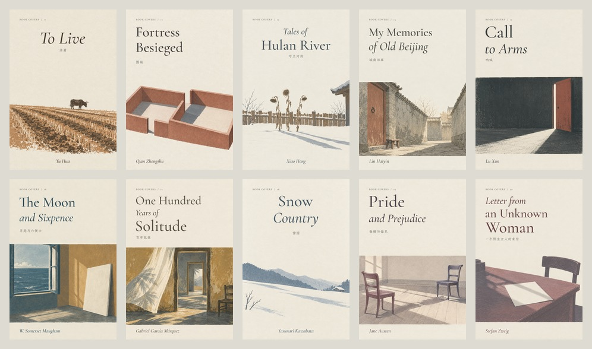

# Volume II: Observations from ten new covers

[简体中文](README.md) · [Browse Volume II](https://zjuzhiyucai.github.io/book-covers/en/?shelf=volume-2#collection)

16 October 2026. Ten new works were made with **Book Covers Skill 1.4.0**, keeping its instructions and renderer unchanged. Each work has text-free PNG artwork, separate Chinese and English typeset PNGs, and a standalone prompt TXT.

Later update: _The Moon and Sixpence_ has been [redesigned following reader feedback](../../revisions/moon-sixpence-2026-10-16.md). Images, observations and hashes here still describe the original trial. Its replay spec now points to the archived original artwork and prompt.

**Typography and file delivery were consistent. Restraint in the generated illustrations still required editorial judgment.** This is an agent-directed case series on one host, not a hands-off benchmark or a general success-rate estimate.



## What was checked

Five Chinese and five international works covered Chinese titles of 2–9 characters, English titles of 7–29 characters, one to three title lines, upright vertical Chinese, brush type, Latin italics, long author names and the accents in García Márquez. The agent wrote a separate visual brief and type plan for every work, inspected the artwork, and reviewed both language covers at large size and as thumbnails. Small author lines need the larger view for comfortable reading.

The installed skill's standalone renderer composed the files. The same inputs were then exported again to a separate directory, and compared by SHA-256. Gallery outputs were also compared against the installed renderer. The baseline is commit `e177a920978348d9a529f887de7c72b0f51024f2`; file hashes and environment details are in [verification.json](verification.json).

| Check                                | Observed result                                                                         |
| ------------------------------------ | --------------------------------------------------------------------------------------- |
| Image calls                          | 10 generations and 1 edit; all returned images                                          |
| First-draft editorial acceptance     | 9 of 10, including two accepted with reservations                                       |
| Image revision                       | One edit to _Fortress Besieged_, removing unsolicited objects                           |
| Selected artwork                     | 10 PNGs at 1024 × 1536, without generated lettering or programmatic cropping/repainting |
| Initial typography                   | All 20 language layouts exported successfully; no type-plan revisions                   |
| Delivery                             | 10 raw PNGs, 20 typeset PNGs and 10 prompt TXT files                                    |
| Same-host repeat                     | All 40 file hashes matched                                                              |
| Illustration preservation            | All 20 composed images preserved source pixels in y=640–1339                            |
| Installed skill / gallery comparison | All 20 typeset PNGs and 10 prompt files matched                                         |
| Warm repeated composition            | About 0.38–0.45 seconds per bilingual four-file delivery                                |

The initial font cache had three required faces but lacked Zhuque Fangsong. The runtime successfully downloaded and verified it; no font substitution or image-generated lettering was used. The first preparation was not precisely timed and is excluded from warm timing results. Image-call times include possible queueing and are not a model-speed benchmark.

## Editorial observations

- **To Live:** the small ox and long field read clearly, but the soil and stubble are more detailed than requested.
- **Fortress Besieged:** the first image added trees, a pot, a bench and leaves. One edit removed them and reduced distress. Its viewpoint still feels somewhat like an architectural model.
- **Tales of Hulan River:** snow, stalks and vertical type work together; fence slats and twigs could be reduced.
- **My Memories of Old Beijing:** accepted with reservations. The low stool supports the child's viewpoint, but brickwork and roof details are busy.
- **Call to Arms:** the dark room and thin opening are particularly clear. The scene starts slightly above the requested boundary without reaching the type.
- **The Moon and Sixpence:** the blank canvas and open window form a clear relationship; the long author name fits. Art starts around y=620, above the requested boundary but below the actual title region.
- **One Hundred Years of Solitude:** accepted with reservations. Doorways and curtain create depth, but an added chair, palm shadow and mottled plaster weaken the restraint. Diacritics render correctly.
- **Snow Country:** open snow and a small warm window keep their distance. Added mountain and tree silhouettes remain quiet.
- **Pride and Prejudice:** chair angles and approaching shadows are legible; floorboards and chair curves are finer than requested.
- **Letter from an Unknown Woman:** the Chinese title stays equal in scale over two lines; English reads in order over three. The letter is blank, though an unrequested stack appears at the left edge.

“Accepted” means selected for this collection, not literal compliance with every prompt instruction.

[Call log and observations](observations.json) · [Repeat hashes](render-results.json) · [Verification](verification.json) · [Replay specs](specs/)

The _Fortress Besieged_ [first draft](../../../process/vol-02/fortress-besieged-v1.png), [edit prompt](../../../prompts/fortress-besieged-refinement.txt) and [selected art](../../../artwork/fortress-besieged.png) are retained. Its downloadable [standalone recipe](../../../prompts/fortress-besieged-recipe.txt) incorporates the intended simplification; it is not the verbatim prompt of a single historical generation call.

## Limits and next improvements

“Fewer details” is not a hard constraint. Old buildings, furniture and earth attract extra texture or plausible props. Numeric whitespace instructions are approximate too: inspect the actual lettering against the actual picture.

The batch also repeats rooms, thresholds and chairs. This partly reflects the briefs chosen by the creating agent, not just the image model. Review diversity across the collection, as well as quality within each cover.

Glyph, boundary and checksum checks do not establish literary specificity or outstanding design. Independent human review remains valuable. There were no multi-seed generations, independent agents, other image models, cross-platform rasterization trials or print proofs. Identical typeset files on this host do not imply repeatable image-generation pixels.

## Gallery integration

Counts and filters now support twenty works and a separate Volume II selection. Promotional sheets are split by volume to avoid overflowing a six-cover canvas.

Revision pages now use each work's actual edit prompt, input and explanation, rather than describing every edit as an author-margin correction. An initial integration test rejected the legacy string revision reason after a bilingual-object check was added. Backward compatibility was restored and regression coverage added; all 19 tests passed. This was a gallery integration issue, not a portable-renderer failure.

Browser checks passed: Volume II shows 10 works, All works shows 20, and language switching preserves the filter. The artwork toggle and Fortress Besieged revision record work. At 390 × 844, neither the collection nor the long-English-title page has horizontal overflow. Download targets and copy payloads were inspected; browser download and clipboard round trips were not asserted.

## Replay the composition

To replay a saved spec from the repository root, after preparing runtime dependencies:

```sh
node skills/book-covers/runtime/compose.mjs \
  --spec docs/stability/vol-02/specs/unknown-woman.json \
  --out output/stability-replay/unknown-woman \
  --receipt output/stability-replay/unknown-woman-audit.json
```

Use a fresh output directory. Substitute the installed skill's renderer path to test that installation. Repeat each spec into a second directory and compare SHA-256. See [runtime setup](../../../skills/book-covers/references/runtime.md). This replays typography on saved artwork, not stochastic image generation.

Bibliographic checks: [Penguin, Fortress Besieged](https://www.penguin.co.uk/books/57471/fortress-besieged-by-zhongshu-qian/9780141915722), [SAFRAN, Tales of Hulan River](https://safranbook.com/en/catalog/tales-of-hulan-river/), [Cypress, My Memories of Old Beijing](https://cypressbooks.com/my-memories-of-old-beijing-9787020134946.html), and [Pushkin Press, Zweig](https://pushkinpress.com/book/letter-from-an-unknown-woman-and-other-stories/). Visual concepts are independent interpretations, not excerpts.
