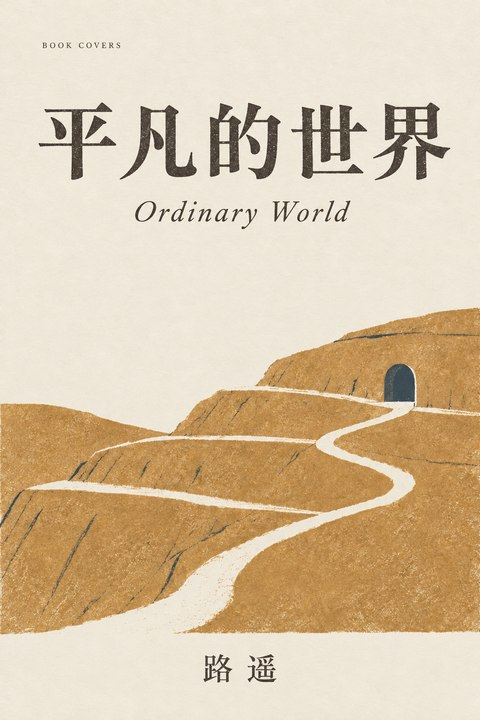

# Complete covers without font setup

Use this route when the host has image generation but no convenient font files/layout tools, or when the user requests custom drawn letters. Generate a finished cover containing the exact book title and author. Font installation, Node.js and this repository's renderer are unnecessary.



This tested example has equal-scale Chinese title characters, an English subtitle and the exact author name. It is an image edit, not a font-file composition.

## Prompt the lettering as part of the composition

Resolve the title and author first. Describe a letterform direction (engraved, restrained brush, humanist serif), not a claim to use a specific font. Give the title and author their own quiet fields in the image. For Chinese, all characters of one title have equal visual scale and weight across lines; do not promote a noun or shrink a connective character. Natural differences in strokes are welcome. English can follow phrase-level hierarchy when it helps the composition.

```text
Create ONE complete literary front cover, portrait 2:3, flat artwork, no mockup.
Warm ivory paper, spare printmaking, two muted ink colours, generous negative space.
Book and emotional scene: [verified work, author, one spatial relationship].
Exact main title: "[title]".
Title treatment: [engraved / restrained brush / display serif], integrated with the paper and ink.
For a Chinese title, use one equal character scale and weight for the entire title.
Line breaks, if needed: [meaningful breaks]; no smaller first phrase or oversized last word.
Exact author: "[author]", smaller but clearly readable in a quiet bottom margin.
Optional translated subtitle: "[exact translation]", distinctly secondary.
Do not add publisher names, endorsements, fake signatures, extra wording or unreadable glyphs.
The final image must contain the title and author, not just the illustration.
```

For an existing illustration, supply it as the edit target and name the invariants: scene, palette, scale and composition. Ask to add or repair lettering only. Keep the input intact. Image editing may still alter scene pixels; do not promise pixel-for-pixel preservation.

## Review the actual image

- Read every character of title and author, including small punctuation and translated text. OCR can assist but cannot certify an artistic glyph.
- Check equal Chinese title scale, reading order, margin clearance, contrast and author legibility at about 180 px wide.
- Repair a misspelled character or uneven word as a targeted edit. Keep an accurate version rather than accepting a more decorative typo.
- If accurate text cannot be achieved, switch to a licensed local-font composition when available. If neither route works, report the unresolved lettering; do not call the cover finished.

Deliver the complete image, exact prompt and source/edit provenance. Do not invent an editable font layer for generated pixels. Distinguish generated lettering from a named font and identify any changed illustration details.
