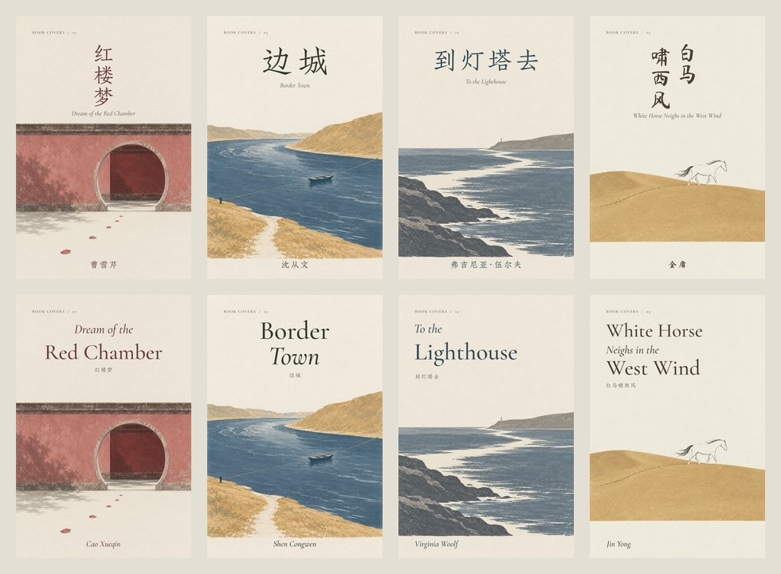

# Typography with a literary voice

Read this when creating a typeset cover or revising its title and author. The founding layout used one body-oriented serif for everything; it was legible but felt like annotation. The revised direction gives each script its own letterforms and each title its own shape.

Typography is a required part of a cover deliverable. Start by sketching the title's silhouette and the author's place, then generate art that leaves room for both. Judge and show the combined result, not the two layers independently. Export the lettering into the final image so its intended faces and positions survive download, sharing and website display.

The four approved anchors are 红楼梦, 边城, 到灯塔去 and 白马啸西风. The top row shows Chinese setting; the bottom row shows the corresponding English setting. These are decision examples, not a grid to impose on every book.

## Choose the voice, then the face

| Role | Useful direction | Current reference |
|---|---|---|
| Chinese literary title | Engraved forms, open falling strokes, natural weight variation | Zhuque Fangsong |
| A lyrical or wuxia title that benefits from a written gesture | A controlled brush face with recognisable characters | Ma Shan Zheng, used selectively for 白马啸西风 |
| English title | A display serif with a strong large-size silhouette | Cormorant Garamond, medium weight |
| English connective phrase or author | A real italic with its own drawn letterforms | Cormorant Garamond Italic |
| Chinese author | A quiet engraved or written form with room around a short name | Usually the Chinese title family |

These faces are examples. Another face may better suit the work or the user's preference. The three families above have OFL sources linked below; preserve their notices when distributing font files. The standalone skill includes a portable renderer, specimens, pinned font hashes and OFL notices. It downloads only needed font files into a local cache and reads them directly; no OS font installation. See [runtime usage](runtime.md). Never silently substitute and claim the intended face was used.

Avoid fake slanting, horizontal stretching, faux bold and random glyph rotations. A brush font is not automatically more artistic, and neither a title nor an author's name should resemble an invented personal signature.

## Shape the title

Start with exact wording and meaningful breaks. Choose a shape that responds to the picture's mass, horizon and empty field.

- **Equal-scale Chinese:** `平凡的世界`, `基督山伯爵` and `钢铁是怎样炼成的` are each one title. Use one character size and weight throughout, whether on one line (`平凡的世界`) or wrapped (`钢铁是怎样 / 炼成的`). A clear axis, line spacing or brush rhythm can shape the title without inventing a word hierarchy. Do not stretch a short line to match a long one or shrink only the longest line; fit the title as a unit.
- **Open, short Chinese:** `边城` can occupy one generous line. Increase size before scattering two characters across the full page.
- **Vertical Chinese:** `红楼梦` can form one upright column; `白马 / 啸西风` can form two, read down each column and from right to left. Keep glyphs upright. Do not rotate a horizontal string by 90°. Handle punctuation explicitly if it occurs; the reference renderer's vertical mode currently targets short unpunctuated Chinese titles.
- **English phrase hierarchy:** in `The Count of / Monte Cristo`, the lighter italic phrase yields to the principal name. In `Ordinary / World`, a restrained italic second line creates a different rhythm. Use a few deliberate changes, not alternating fonts on every word.
- **Long English titles:** retain syntax and word order across two or three lines. Never force an entire long title to a tiny size just to mimic the Chinese cover. Normal mixed-case titles need natural spacing; widely tracked capitals are a different choice, not a universal effect.

Keep a common paper, ink family, imprint and set of margins across the collection. Variation belongs chiefly in the title silhouette and type roles. Not every cover needs a vertical title, italic word, or decorative rule.

## Give the author a place

The name is part of the composition. For a 1024 × 1536 reference cover, roughly 42–52 px works as a starting point, compared with the earlier 30 px; verify the real glyph height. Short Chinese names can use restrained tracking, around 0.1–0.17 em. English names can use a medium-weight italic at natural spacing. These are specimen ranges, not mandatory sizes.

Align the author with the title's left edge or central axis. Keep it above the trim and separate from the illustration. A long transliterated author name must retain punctuation and all characters; choose a complete face or a clearly documented fallback, rather than dropping a missing dot or syllable. Do not invent translators, publishers or endorsements.

The translated subtitle is secondary: smaller, quieter, and not pressed against either the title or the illustration. A full bilingual title need not appear if the user wants a single-language cover.

## Fit and inspect

Use actual ink bounds, including italic overhangs and CJK sidebearings. Font advance width alone can miscenter a title or clip an italic. Prefer a better line break over excessive shrinking. Compare Chinese and English at full size and about 180 px wide; inspect the author too, not just the headline.

For a revision, compare before and after on identical artwork. Check reading order, exact spelling, diacritics, margin clearance, line collisions and contrast. New decorative detail does not compensate for weak hierarchy. Keep source artwork intact when changing only the type layer.

Before delivery, open the actual exported file: both title and author must be present in its pixels, readable, correctly spelled and part of a clear hierarchy. Check the second language independently. A filename, caption or HTML label containing the title does not replace title lettering on the cover.

## Reference implementation

The Book Covers repository uses `titleLines.zh/en` for semantic text breaks, and optional `typography.zh/en` plans for their treatment:

- `mode`: `left`, `centered`, or Chinese `vertical`.
- Horizontal Chinese `size`: one size for the whole title. Legacy `sizes` must have identical entries; the renderer fits all Chinese lines together. English `sizes` may vary by phrase. `baselines` and `offsets` have one entry per line, in the 1024 × 1536 coordinate system. `tracking` adjusts spacing; English `italicLines` contains zero-based indices.
- Vertical `size`, `top`, `leading`, `centers`, `topOffsets`: positions for short Chinese columns; center coordinates descend from right to left. Individual glyphs remain upright and optically centered.
- Chinese `face`: `zhuque` or `brush`; English uses separate roman and italic files. `ink` is an optional dark six-digit hex colour drawn from the composition.

The renderer derives the secondary title and author roles and checks real glyph bounds. These plans are editable starting points, not a universal layout algorithm. `npm test` and `npm run build` verify all current covers; still inspect the rendered output visually. Font outlines and positions are stable, but different native rasterizers can produce tiny antialiasing differences across operating systems.

For a book outside the public catalog, use the portable [runtime](runtime.md), also exposed as `npm run compose` in the gallery. It accepts one or both requested languages and emits three output types: intact text-free PNG, typeset PNG per language, and the supplied complete prompt TXT. WebP and a provenance receipt are opt-in. Existing outputs are protected, and input images are never overwritten.

## Font sources

- [Zhuque Fangsong / 璇玑造字](https://github.com/TrionesType/zhuque) — the repository pins preview v0.212 and validates the glyphs used in this collection.
- [Cormorant / Christian Thalmann](https://github.com/CatharsisFonts/Cormorant) and [Google Fonts distribution](https://github.com/google/fonts/tree/main/ofl/cormorantgaramond).
- [Ma Shan Zheng / Google Fonts](https://github.com/google/fonts/tree/main/ofl/mashanzheng).

Artwork and specimen reuse: [asset provenance](ASSETS.md).
